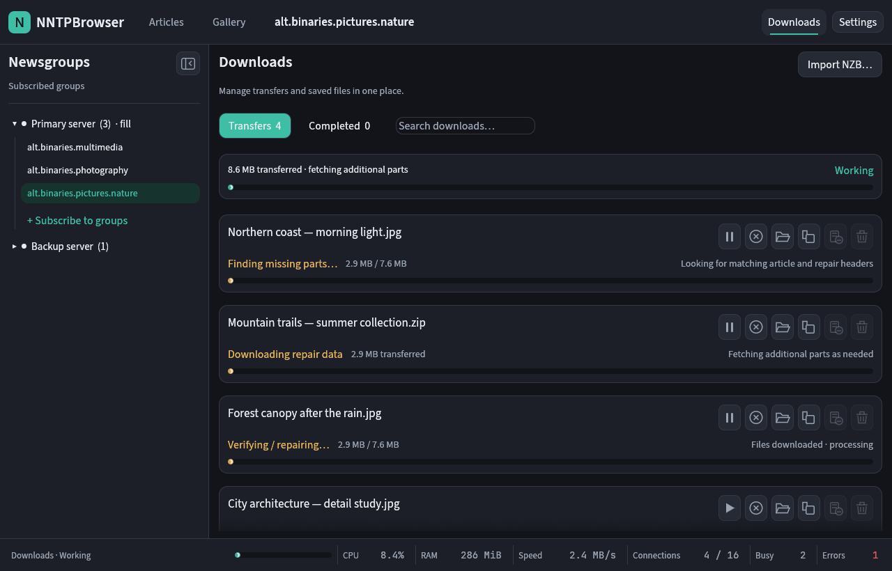

# NNTPBrowser

A native Rust/egui Usenet browser for articles and files. It uses its own NNTP client, a compressed header cache, and a SQLite catalog for subscriptions and downloads.

[Project site](https://mnj.github.io/nntpbrowser/) · [Downloads](https://github.com/mnj/nntpbrowser/releases) · [Release automation](docs/releases.md)

## Run

```sh
cargo run -p app --bin nntpbrowser
```

Add a server in **Settings**, then choose **Subscribe to groups** in the left sidebar. **Compare layouts** opens a proof of concept with eight group-list designs and sorting controls, using the loaded groups and current filter when available. Selecting a group with no cached headers automatically fetches its latest **10,000** headers. Cached groups open locally; an empty search or date filter does not trigger a fetch. To fetch more, choose **Latest**, **New only**, or **All available**, choose a header-count preset from **10,000** to **10 million** when using Latest, then press **Get article headers**. Switch between **Articles** and **Gallery**. The article view has a resizable table/details split. Download selected article files or use **Download range** to download the newest N/all articles matching your search. Download range applies to all file types in the cached group matching the search, including pages not yet displayed. **Download selected** uses checked articles; **Download this article** uses the open article. The **Filter** menu narrows the displayed list to images and videos, images, several files, PAR2 repair files or articles with missing parts. The count describes cached articles currently shown, not the server total.

**New only** fetches headers above the stored watermark; increasing the **Latest** count or choosing **All available** backfills older missing spans. A single header button runs the selected scope. The taller status bar reports the range checked separately from received and cached counts. Its cancel icon stops a header fetch, keeps committed headers, and leaves missing ranges available for the next fetch. Search covers cached article titles. Selecting an article automatically fetches its body.

Gallery’s **Tile size** slider adjusts thumbnail size and remembers it across restarts. Resizing preserves cached previews and updates which tiles are visible. Gallery prioritizes visible tiles as you scroll, cancels unfinished offscreen requests, and reuses completed previews in memory. It fetches known-size image and video previews smaller than the configured limit (10 MiB by default) into RAM, including multipart files with complete headers. Previewing creates no download jobs or files and adds nothing to the Completed view. Its encoded-media cache retains at most the configured budget (64 MiB by default); evicted previews may be fetched again. **Save** explicitly writes the previewed media file. **Download selected**, **Download this article**, and **Download range** queue normal downloads of the article’s files, including larger files. Images open in the in-app viewer; videos show a poster when available or a video icon and can be opened in your system player after saving. Video previews avoid temporary files; seek-dependent formats may fall back to the icon. Gallery date presets and custom inclusive UTC date ranges filter the entire cached group before pagination. Payload decoding supports yEnc, classic uuencode and POSIX begin-base64, including ordered multipart uuencode. UUencode has no embedded checksum; malformed or incomplete streams are rejected. Filename matching preserves complete quoted names and tolerates case, outer quoting and source-directory differences without accepting a different attachment. Other encodings such as BinHex, xxencode and arbitrary MIME attachments are not implemented.

The **Downloads** page combines Transfers and Completed files, with NZB import, pause, resume, cancel and retry. Each download has direct icon actions with tooltips. Completed downloads offer file previews, Open folder, Copy folder path, removal from the list while keeping files, or reviewed deletion of the dedicated download folder. Downloads show per-job and aggregate progress, including decoding/repair/extraction stages. The status bar shows combined NNTP speed, open sockets, recently busy connections, configured connection limits, this app’s RAM and CPU usage, and a timestamped error history with copy and clear actions. Speed uses a five-second trailing average, updated four times a second, so short bursts remain readable. Download rows use the same averaging window. Hover over Speed for session totals of received network bytes, received bytes after NNTP decompression, and sent network bytes, in human-readable units. Totals include connection setup and authentication, exclude TLS overhead, and remain counted after connections or pools close. Decompressed totals count consumed NNTP responses, before attachment decoding. Hover over Connections for a scrollable list of live sockets by server, with connecting/waiting/sending/receiving/idle states, five-second send/receive speeds and transferred byte totals. Activity reflects the latest 250 ms sample; closed sockets disappear. The status bar uses a single row with inline labels and values. Each statistic has a fixed-width segment, so changing values and units keep neighboring readouts in place. RAM is resident process memory; CPU is sampled once a second, with 100% representing one fully busy core (it can exceed 100% across multiple cores).

**Settings** separates Appearance, Network, Storage and Servers. Appearance controls interface scale and browsing defaults; Network controls preview size, RAM cache budget and connection timeout. Gallery opens connections on demand up to each server’s connection limit, including servers configured for 50 or more connections. Visible files and multipart segments can fetch concurrently; previews, downloads and headers share the same server limit. The old separate four-preview limit is removed. Server settings offer implicit TLS, STARTTLS or plain NNTP, account credentials and download connection limits. Preferences persist across restarts.

Downloads keep small PAR2 indexes and defer the larger recovery volumes. When parts are missing or damaged, automatic recovery looks for matching headers, fetches any newly found payload parts, then downloads repair volumes as needed. It verifies the selected recovery set and repaired files before completion. Known NZB repair volumes use their supplied message IDs; browsing downloads can search around their original article numbers when the local headers are incomplete. Discovery is bounded, and further repair downloads stop once the files verify. Candidates and completed search ranges persist across restart. Downloads shows **Finding missing parts**, **Downloading repair data**, then **Verifying / repairing**, with pause and cancel actions. Incomplete sequential uuencode streams and jobs needing multiple independent repair sets still fail; recovery cannot restore data when the available repair blocks are insufficient.



## Headless commands

```sh
cargo run -p app --bin nntpbrowser -- help
cargo run -p app --bin nntpbrowser -- servers
cargo run -p app --bin nntpbrowser -- groups 1
cargo run -p app --bin nntpbrowser -- subscribe 1 alt.binaries.pictures
cargo run -p app --bin nntpbrowser -- sync 1 --limit 10000
cargo run -p app --bin nntpbrowser -- sync 1 --all
cargo run -p app --bin nntpbrowser -- posts 1
```

GUI and CLI share the platform data directory. `NNTP_PASSWORD` supplies a server password without putting it in a command argument. Run `help` for all commands.

## Storage

On Linux, the default data directory is `~/.local/share/nntpbrowser` (or `$XDG_DATA_HOME/nntpbrowser`). It contains `catalog.sqlite`, `headers/`, `article-bodies/`, `downloads/`, `thumbs/`, and `preferences.json`. The database's WAL/SHM files sit alongside it. Selected article bodies are cached as fast, checksummed zstd level-1 `.body.zst` files in `article-bodies/`, with bounded 4 MiB reads; older raw `.body` entries remain readable and migrate to zstd when used; `thumbs/` contains generated thumbnails for explicit downloads. Temporary Gallery previews and their decoded thumbnails stay in RAM. Unsubscribing deletes the group row and its derived caches; explicit saved/downloaded files and download history remain.

**Settings → Storage** shows the current paths. The downloads directory affects new saves/downloads; existing jobs keep their destination. A custom data directory takes effect after restarting both GUI and CLI. It selects a separate data workspace; existing data remains in its original directory. The small bootstrap file is `~/.config/nntpbrowser/storage.json` (or `$XDG_CONFIG_HOME/nntpbrowser/storage.json`).

Raw overview records live in immutable, zstd level-3 compressed OSF1 files with block checksums and an article-range index. SQLite stores servers, subscriptions, grouped multipart metadata, jobs, queued download segments, durable recovery candidates/search progress and thumbnail paths. SQLite remains a regular live database so transactions and indexes remain usable; it is not wrapped in whole-file compression. Selected article bodies use zstd level 1 with checksums and bounded decompression. Saved JPEG/PNG/video/archive files retain their native formats, and generated thumbnails remain JPEG files. Gallery preview bytes and decoded preview images stay in RAM until the user saves a file. The SQLite catalog migrates existing server settings to add STARTTLS selection and job recovery metadata; the compressed header format remains unchanged. Older versions may also have a `media-cache/` directory containing Gallery files and completed jobs. Startup cancels unfinished legacy Gallery jobs. Existing completed cache files remain until removed through Downloads or their group is unsubscribed; their history entries remain detached after unsubscribe. Current Gallery browsing creates no disk media cache.

Compaction streams blocks, preserving historical gaps. A small durable journal recovers the boundary between header publication and catalog updates without missing articles or doubling file sizes. Bulk queueing scans headers once and uses a temporary SQL lookup instead of retaining all segments in Rust memory. SQLite recovers interrupted transfers when reopened, while paused jobs remain paused. An exclusive process lock prevents concurrent GUI/CLI writers, and deleting a server clears its header cache before its ID can be reused. Recovery protects new writes; it does not automatically repair catalog inconsistencies or hidden historical gaps created by older versions.

The reproducible benchmark compares this hybrid against normal per-header SQLite rows:

```sh
cargo run -p store --example storage_bench --release -- 200000
```

In one local synthetic 200,000-header run, the compacted header cache plus grouped catalog occupied about **7.4 MB**, versus **37.3 MB** for per-header SQLite rows or **51.5 MB** with a message-ID index. Compressed cache writing and compaction took about **0.32 s**; indexed SQLite insertion took about **1.58 s**. This is a synthetic, warm-filesystem comparison, not a real-provider throughput prediction. SQLite containing compressed BLOB blocks could approach the custom cache's size; that alternative has not been benchmarked.

## Dependencies and licensing

NNTPBrowser's own code is MIT-licensed; dependencies, embedded fonts and trust-store data retain their respective licenses. Feature cleanup removed eight unused locked packages without changing retained versions. The [dependency audit](docs/dependencies.md) records the selected features, MPL/font/native-code notice requirements and remaining release materials. A binary-release third-party notices/source bundle has not yet been generated.

## Layout review and validation

[Articles](docs/articles.png) · [Gallery](docs/gallery.png) · [Memory preview](docs/gallery-memory.png) · [Group picker](docs/groups.png) · [Servers](docs/settings.png) · [Appearance](docs/settings-appearance.png) · [Network](docs/settings-network.png) · [Storage](docs/settings-storage.png) · [Download progress](docs/downloads.png) · [Header progress](docs/headers.png) · [Article body](docs/article-body.png) · [Error history](docs/errors.png)

An isolated offline fixture makes the UI reviewable without a server or user data:

```sh
cargo run -p app --example preview --features ui-preview -- articles
cargo run -p app --example preview --features ui-preview -- gallery
cargo run -p app --example preview --features ui-preview -- gallery-memory
cargo run -p app --example preview --features ui-preview -- groups
cargo run -p app --example preview --features ui-preview -- options
cargo run -p app --example preview --features ui-preview -- queue
```

Use `gallery-small` and `gallery-large` to inspect tile-size limits, `article-text` to inspect a fetched text body, `options-appearance`, `options-network` and `options-storage` for global settings, `options-account` and `options-downloads` for server tabs, `errors` for the error dialog, `headers` to inspect header progress, `empty` for an empty group, `sidebar-collapsed` for the compact restore rail, and `groups-loading` to inspect the reserved loading viewport. Add a width or `WIDTHxHEIGHT` (for example `1040x680`) as the next argument to check smaller windows. For an automatic PNG screenshot and exit, enable `eframe/__screenshot` and append the output path after the width:

```sh
cargo run -p app --example preview --features ui-preview,eframe/__screenshot -- gallery 1280 /tmp/gallery.png
```

```sh
cargo fmt --all -- --check
cargo test --workspace --all-features
cargo clippy --workspace --all-targets --all-features -- -D warnings
cargo build -p app --bin nntpbrowser
```

Tests use fake local NNTP servers; no provider account is needed. A separate Eweka check fetched 20,010 headers into an isolated cache using plain XOVER, compressed XZVER and XFEATURE. The client refreshes capabilities after login and supports binary zlib responses, yEnc-wrapped XZVER and both XFEATURE framing variants. Header progress is shown in the GUI and CLI. RAR extraction requires an external `unrar` or `unar`. Downloads use configured per-server connection limits and FIFO BODY pipelines. Header commands share the server connection budget; their overview ranges remain serial and bounded. Pipeline windows adapt to pending work and estimated size, so the configured depth is a ceiling. The client implements core NNTP newsreader commands and selected extensions; see the [NNTP support matrix](docs/nntp-support.md). See [plan.md](plan.md) for protocol and product decisions.
